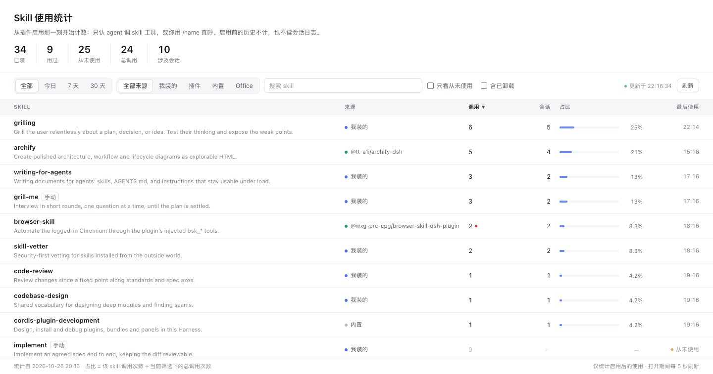
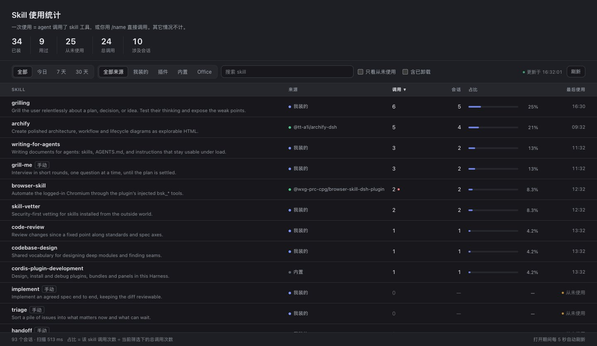

# dsh-skill-stats

[简体中文](README_zh.md)

[](./LICENSE)
[](package.json)
[](https://github.com/HLhhh/dsh-skill-stats)

**Which skills are actually being used — and which ones you installed and forgot.** A left-sidebar panel for [DeepSeek Harness](https://github.com/deepseek-ai/deepseek-harness) that lists every installed skill with its use count, the number of conversations it appeared in, and its share of all skill use.



*Screenshots use sample data; the panel itself reads your own local session logs.*

## Why

Harness shows you *which skills exist*. It does not show you *which skills you use*. Two consequences:

- A skill you installed months ago and never touched looks exactly like your most-loaded one.
- A skill you rely on constantly has no evidence you can point at.

This panel answers both with the smallest honest dataset: the two moments where a skill is really used.

## What counts as one use

Exactly two signals, both taken from the session log:

1. an agent calls the `skill` tool (`tool/call` with `name: "skill"`, the requested skill in `arguments.name`);
2. you invoke a skill directly with `/name` (`user/message` whose `source.kind` is `skill-invocation`).

Nothing else counts. A skill merely being listed in the prompt, an agent `read`-ing a `SKILL.md` file, or a panel being opened is not a use.

| Column | Meaning |
| --- | --- |
| Calls | Number of the two signals above, in the selected time window |
| Sessions | Distinct conversations that used the skill |
| Share | This skill's calls ÷ every counted call in the current filter |
| Last used | Timestamp of the most recent use |
| Source dot | Where the skill comes from: you, a plugin, bundled with Harness, a project, or uninstalled |

## Features

- **Every installed skill is listed**, including skills that are only callable as `/name` (they carry a small `manual` tag) and plugin-provided skills.
- **Honest source labels.** `bundled` in the skills service only means "from a bundled skill root", so origin is resolved from the file's real location: a plugin's own `skill/`/`skills/` directory is labelled with that plugin's package name.
- **Never a stale snapshot.** The panel rescans on every open and every five seconds while open; finished session files are re-parsed only when they change, so a rescan costs milliseconds in the steady state.
- **Time windows and filters**: all time, today, 7 days, 30 days; filter by origin; search; "never used only"; optionally include skills that are no longer installed.
- **Fork-aware.** Continued/forked sessions replay the parent's events; inherited events and duplicate call ids are dropped so one call is never counted twice.
- **Local only.** It reads your own session logs. No network requests, no telemetry.



## Install

This package is plain JavaScript — no build step.

### From GitHub (recommended until the npm release)

```sh
dsh plugin --profile web add github:HLhhh/dsh-skill-stats
```

Replace `web` with your profile name if it differs.

### From a local checkout or tarball

```sh
npm pack                                   # produces dsh-skill-stats-0.1.0.tgz
dsh plugin --profile web add ./dsh-skill-stats-0.1.0.tgz
```

### From an agent session

Point the plugin manager at the package directory:

```text
plugin_manager install_bundle target=/absolute/path/to/dsh-skill-stats
```

After installing, refresh the page once — the sidebar icon appears next to the other panel icons.

### Update / remove

```sh
dsh plugin --profile web update github:HLhhh/dsh-skill-stats
dsh plugin --profile web remove dsh-skill-stats
```

## Usage

| Entry | What it does |
| --- | --- |
| Sidebar bar-chart icon | Opens the Skill usage panel |
| Panel header | Installed / used / never used / total calls / sessions |
| Filter bar | Time window, source, search, never-used-only, include uninstalled |
| Table header | Click any column to sort; click again to reverse |

Nothing else registers: no tools, no slash commands, no changes to other panels.

## Compatibility

| Surface | Status |
| --- | --- |
| DeepSeek Harness | `0.2.x` (built and tested against `0.2.1-rc.3` Desktop and Web) |
| Node | `^22.19.0 \|\| >=24.0.0` (uses `zlib.zstdDecompressSync`) |
| Platforms | Desktop and Web profiles with the skills feature |

## How the inventory is built

`ctx.skills.list()` only reports the layer visible to a host plugin's own scope, and a desktop profile mounts `~/.dsh/skills` inside the agent preset's standing composition. Listing that alone would mislabel every user-installed skill as "uninstalled". The panel therefore merges three sources and de-duplicates by name:

1. `ctx.skills.list()` — everything the global scope can see;
2. the disk skill roots — `$DSH_HOME/skills`, `~/.agents/skills`, `$DSH_BUNDLED_SKILL_DIR`, and the `.dsh/skills` / `.agents/skills` of working directories seen in the session corpus, parsing `SKILL.md` frontmatter (CRLF and BOM tolerant, `disable-model-invocation` respected);
3. the per-session skill-catalog snapshot (`source.kind === "skill-catalog"`), which names plugin/preset skills the service did not expose.

## Known limitations

- A skill that is neither on disk nor present in any session's catalog snapshot cannot be discovered, because Harness has no cross-scope "list every installed skill" API.
- The catalog snapshot is historical: if a plugin that provided a skill is uninstalled, the name can linger in the list.
- Duplicate skill names are resolved to the effective one; the shadowed copy is not shown.
- Failure marking relies on `tool/result` carrying `isError`; other failure shapes are not attributed.

## Development

```sh
npm test          # syntax + behavior smoke tests, no dependencies
npm pack --dry-run
```

Repository layout:

```
index.js            host half: session scan, aggregation, /dsh-skill-stats/api
client.js           browser half: sidebar icon + panel (plain JS, no build)
cordis.patch.yml    one Loader row
locale/             plugin-manager title/description (en, zh)
icon.svg            plugin and sidebar icon
docs/               screenshots
test/smoke.mjs      dependency-free smoke tests, also run in CI
```

## License

MIT — see [LICENSE](./LICENSE).
